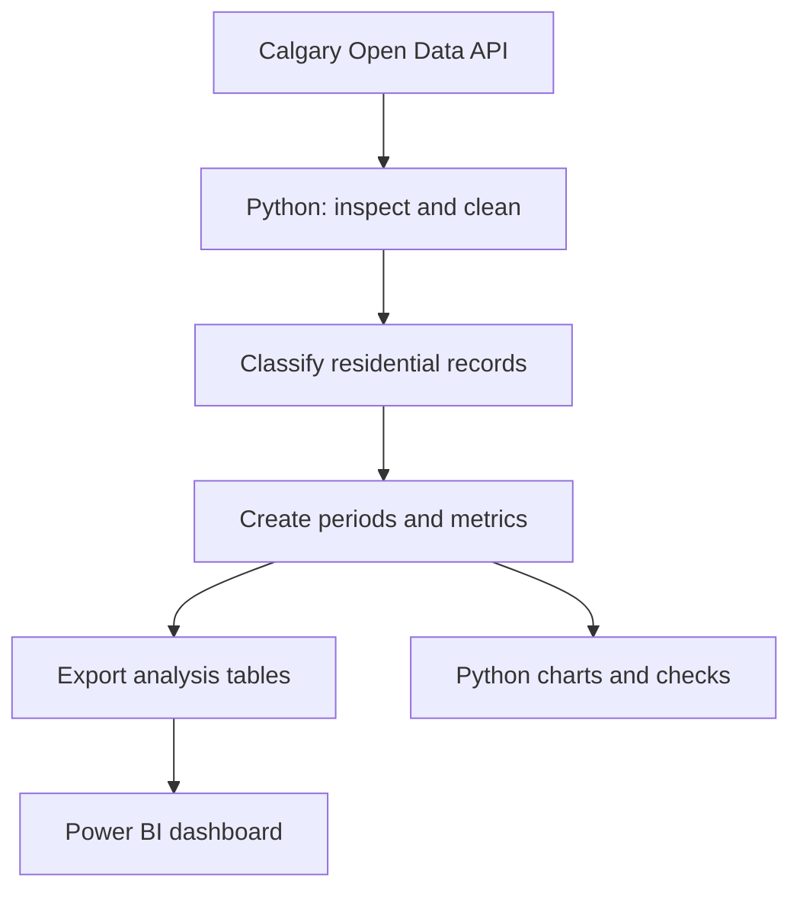

# Calgary Development Permit Activity

**DATA 110 Mini-Capstone Project**

This project examines how Calgary residential development-permit activity differed before and during the city's citywide rezoning period. It uses Python for data acquisition, cleaning, transformation, and exploratory analysis, then Power BI for interactive reporting.

The project studies **observable differences and associations**. It does not claim that rezoning caused every change in permit activity.

## Copyright and academic integrity

Copyright © 2026 Albert Leung. All rights reserved.

This repository contains an original academic project. It may be viewed for reference, but its original code, documentation, analysis, visualizations, Power BI materials, and presentation materials may not be copied, modified, or submitted for academic credit without prior written permission.

See the [copyright notice](LICENSE.md) and [academic integrity policy](ACADEMIC_INTEGRITY.md). City of Calgary source data is separately licensed under the Open Government Licence – City of Calgary and is not covered by this project's copyright restrictions.

## Research question

> What differences in Calgary residential development-permit activity can be observed before and during citywide rezoning?

The analysis focuses on six supporting questions:

1. Did monthly residential development-permit volume differ between the two periods?
2. Did the mix of residential development types change?
3. Which communities experienced the largest absolute and percentage changes?
4. Did typical processing time differ?
5. Did the share of rezoning-relevant residential permits change?
6. How did permit activity vary by season within each policy period?

## Study periods

The primary comparison uses two nearly equal periods and classifies permits by `AppliedDate`.

| Period | Start | End | Use in analysis |
|---|---:|---:|---|
| Before rezoning | 2022-08-06 | 2024-08-05 | Primary comparison |
| During rezoning | 2024-08-06 | 2026-08-03 | Primary comparison |
| Early post-repeal | 2026-08-04 | Latest available date | Context only; incomplete |

August 6, 2024 is the implementation date for Bylaw 21P2024. Calgary's repeal-related zoning changes took effect on August 4, 2026. The short post-repeal period is not treated as equivalent to the two primary periods.

## Data source

The primary source is the City of Calgary's [Development Permits](https://data.calgary.ca/Business-and-Economic-Activity/Development-Permits/6933-unw5) open dataset.

- Dataset ID: `6933-unw5`
- Publisher: The City of Calgary
- Unit of observation: one development-permit application
- Unique identifier: `PermitNum`
- Access: Socrata Open Data API and downloadable CSV
- API endpoint: `https://data.calgary.ca/resource/6933-unw5.json`

Important fields include application, decision and release dates; category and proposed use; land-use district; permit status and decision; community and ward; and latitude/longitude.

## Planned workflow



Python and Power BI serve different roles while using the same definitions:

- **Python:** retrieve, profile, clean, classify, validate, summarize, visualize, and export the data.
- **Power BI:** provide interactive comparisons by period, community, ward, permit type, status, and land-use district.

Socrata results can be saved as CSV, JSON, or GeoJSON by filename extension, or as Parquet when a compatible engine is installed. The committed settings request CSV and Parquet raw snapshots and a combined Excel workbook for processed outputs. Processed table export supports CSV, JSON, Parquet, and Excel (`xlsx`). The Conda setup and `requirements-dev.txt` include the Excel extra; `xlsx` is already enabled in `storage.processed_output_formats`. `storage.excel_layout` selects `one_file_per_table` (default) or `one_workbook` with one table per sheet. The file writer uses interchangeable format adapters and can load a custom adapter through a validated Python class path; see [Python Design Patterns](docs/DESIGN_PATTERNS.md).

## Key measures

- residential applications per 30 exposed calendar days (`DP_Rate30 = PermitCount / ExposureDays × 30`), null when exposure is unknown;
- total and monthly residential permit counts;
- average and median monthly permit counts;
- absolute and percentage change between periods;
- development-type count and share;
- permit counts and processing measures by season;
- median processing days and interquartile range;
- rezoning-relevant permits as a share of residential permits;
- community-level change, with small-base warnings for percentage change.

Processing time is defined initially as:

```text
ProcessingDays = DecisionDate - AppliedDate
```

Only non-negative values with both dates present will be included in processing-time summaries. This rule will be checked against the actual data before results are reported.

### Seasonal classification

Each permit will also be classified from `AppliedDate` using meteorological seasons:

| Season | Months |
|---|---|
| Fall | September–November |
| Winter | December–February |
| Spring | March–May |
| Summer | June–August |

Winter crosses calendar years. For example, December 2024 through February 2025 will be labelled **Winter 2024–25**. A season start date and sort key will keep seasons in chronological order in Python and Power BI. Seasons cut by the study boundaries will be flagged as partial rather than compared as though they contained three complete months.

## Repository structure

```text
Data110_DP_Activity/
├── ACADEMIC_INTEGRITY.md
├── LICENSE.md
├── README.md
├── _quarto.yml              # renders the presentation notebook to Reveal.js
├── config/
│   ├── settings.yaml             # project-wide analysis settings
│   └── classification_rules.csv # ordered housing-form classification rules
├── docs/
│   ├── CONFIGURATION.md
│   ├── DATA_DICTIONARY.md
│   ├── DESIGN_PATTERNS.md
│   ├── BIAS_AND_MITIGATION.md
│   ├── DEVELOPMENT_PERMIT_BACKGROUND.md
│   ├── METHODOLOGY.md
│   ├── POWER_BI_PLAN.md
│   ├── PRESENTATION_PLAN.md
│   ├── PROJECT_SUMMARY.md
│   ├── REFERENCES.md
│   └── TESTING.md
├── data/
│   ├── raw/                 # downloaded source data; not committed
│   └── processed/           # cleaned Power BI inputs
├── notebooks/               # exploration and presentation notebooks; slide CSS
├── powerbi/                 # Power BI .pbix file
├── reports/                 # final summary and presentation exports
├── requirements-dev.txt     # pinned local testing dependencies
├── src/                     # reusable Python modules
└── tests/                   # pytest tree mirroring the Python modules
```

Folders and planned files shown above that are not yet present will be added as the analysis is implemented.

## Configuration

Residential applications are those assigned `IncludeResidential=true` by the
ordered classification rules. Included forms cover dwellings, multi-residential
development, and suites, plus qualifying residential renovations and additions.
Mixed-use housing may qualify through housing evidence. Accessory structures,
non-housing uses, and unmatched records are excluded when their rules determine
the outcome. See the [full population definition](docs/CONFIGURATION.md#residential-population-definition).

Both notebooks separate all-permit source exploration from residential-only
profiles, summaries, and charts. `storage.residential_only: true` also restricts
cleaned exports to included residential applications; raw snapshots and full-source
validation/reconciliation remain available. Application counts are not new-home counts.

Analysis choices are kept outside the Python code where practical. [`config/settings.yaml`](config/settings.yaml) contains the data source, study periods, season definitions, quality checks, storage formats, output naming and overwrite behavior, and pipeline-log archive settings. [`config/classification_rules.csv`](config/classification_rules.csv) contains ordered, auditable rules for residential inclusion, housing type, and rezoning-relevance classification. Provisional, fallback, and review rules remain subject to the validation process; being committed does not magically make a rule correct.

See the [configuration and classification-rules guide](docs/CONFIGURATION.md) for the file schemas, validation requirements, rule precedence, and audit process.

The Python modules also identify their architectural or object-oriented pattern and explain why it is used. See the [Python Design Patterns](docs/DESIGN_PATTERNS.md) overview for how the adapters, repositories, pipeline, strategies, rule chain, factories, and functional feature stages fit together.

## Getting started

Use Python 3.10 or newer. Choose Conda or a standard virtual environment.
`pyproject.toml` defines all Python package dependencies and optional extras.
Both `environment.yml` and `requirements-dev.txt` install the `dev`, `parquet`,
and `excel` extras from it.

### Conda

Run from the repository root:

```bash
conda env create --file environment.yml
conda activate data110-dp-activity
python -m dp_activity.cli --help
```

Conda supplies Python 3.13 and pip; the YAML's pip section installs the project
in editable mode with its dependencies, tests, Parquet, and Excel support.
Change package versions in `pyproject.toml` to keep one dependency definition.
After changing Python package dependencies, activate the environment and run:

```bash
python -m pip install -e ".[dev,parquet,excel]"
python -m pip check
```

Recreate the environment from `environment.yml` when changing Conda dependencies
or the interpreter. This specification is not a complete lockfile: Python patch
releases and transitive dependency versions can vary.

In PyCharm, select the existing Conda environment `data110-dp-activity` as the
project interpreter. A default Windows Miniconda installation places it at
`%USERPROFILE%\miniconda3\envs\data110-dp-activity\python.exe`.
Use the same environment for notebook execution in PyCharm.

### Standard virtual environment

From a fresh checkout, create a virtual environment:

```bash
git clone https://github.com/alby1976/Data110_DP_Activity.git
cd Data110_DP_Activity
python -m venv .venv
```

Activate the environment on Windows PowerShell:

```powershell
.venv\Scripts\Activate.ps1
```

Install the package, pinned development dependencies, and Parquet support (required by the committed raw-storage settings):

```bash
python -m pip install -r requirements-dev.txt
python -m dp_activity.cli --help
```

Download the configured study periods from the repository root:

```bash
python -m dp_activity.cli --settings config/settings.yaml download
```

The installed `dp-activity` command accepts the same arguments. Downloads require network access and write timestamped, immutable snapshots plus metadata sidecars to `data/raw`. The optional token is read from `config/dp.env`, using the name `SOCRATA_APP_TOKEN`; a missing file is allowed. See [Configuration](docs/CONFIGURATION.md) for filtering, credentials, and storage details.

The `run` command executes the table pipeline from a frozen raw snapshot:

```bash
python -m dp_activity.cli --settings config/settings.yaml run data/raw/SNAPSHOT.csv
```

It uses the snapshot sidecar's UTC retrieval date, or an explicit
`--observation-end YYYY-MM-DD` override. Offline smoke tests exercise the real
pipeline with synthetic records and CSV, JSON, and Parquet exports. This does not
establish final study validity: failed validation reports still allow export,
sensitivity scenarios remain unconfigured, and full provenance and automatic
charts remain pending. Profiling is available through `DataProfiler.profile()`;
there is no `profile` or `analyse` CLI command.

## Create Power BI analysis files

From the repository root in the activated project environment, create the
combined Excel workbook from the frozen complete-period snapshot. Conda installs
the project dependencies from `pyproject.toml`; `config/settings.yaml` controls
the export format, layout, filename, and destination:

```powershell
python -m dp_activity.cli --settings config/settings.yaml run data/raw/development_permits_residential_20261013_001726.parquet
```

Keep the snapshot's adjacent metadata sidecar. With the committed settings,
the output is `data/processed/development_permits_residential_workbook.xlsx`; rerunning
replaces that file. Use its `permits_clean` sheet for residential permit-level
analysis, and check the validation and reconciliation sheets before reporting.
Each worksheet contains an Excel table named exactly like its sheet (for example,
`permits_clean`). Empty tables contain a blank placeholder row; remove all-null
rows in Power Query. Exports use `.xlsx`.
The CLI workbook was regenerated after the Excel compatibility repair; archive
inspection confirmed 27 worksheets with 27 named tables. Re-export older notebook
workbooks with the updated code to apply the repair.

For environment setup, notebook exports, CSV alternatives, and missing-snapshot
instructions, follow
[Create the Power BI input files](docs/POWER_BI_PLAN.md#create-the-power-bi-input-files).
The complete-period notebook's optional export creates
`reports/notebook_complete_period/<unique-run-id>/tables/complete_period_exploration_workbook.xlsx`
with the current Excel settings. The guide also covers the CLI export to
`data/processed`, the Before-only workbook, table selection, and reconciliation.

## Render the 10-minute presentation

The [presentation notebook](notebooks/03_ten_minute_presentation.ipynb) uses
Quarto Reveal.js with eight timed sections, speaker notes, three charts, and a
detail appendix. Run all notebook cells in PyCharm first, then render from the
repository root:

```powershell
quarto --version
quarto render
```

Quarto **1.10.19** is installed on the author's Windows workstation at
`%LOCALAPPDATA%\Programs\Quarto`, with its `bin` directory on the user PATH.
Restart PyCharm after installation so its terminals inherit the updated PATH.
On another computer, install the [Quarto CLI](https://quarto.org/docs/get-started/)
separately; the Python/Conda setup does not install it.

Open `reports/presentation/notebooks/03_ten_minute_presentation.html` in a
browser. Keep the generated presentation directory together when copying it.
Press `S` for speaker view, `F` for fullscreen, and `Esc` for the overview.
Rendering uses saved notebook output and does not execute Python. Rerun the
notebook before rendering changed data, settings, or rules. Preparation cells
and source code are hidden from the slides. See the
[presentation guide](docs/PRESENTATION_PLAN.md#10-minute-notebook-presentation)
for timing, troubleshooting, and verification limits.

## Running the tests

The [Before exploratory notebook](notebooks/01_permit_exploration.ipynb) and
[complete-period notebook](notebooks/02_complete_period_exploration.ipynb)
were refreshed on **October 12, 2026**. All **19 code cells in each notebook**
completed successfully with current modules; saved tables, review registers,
the monthly chart, and five heatmaps were regenerated.

The Before notebook retains its 16,637-record frozen source snapshot. Cleaning
excludes one blank/null-address application, leaving 16,636 retained records
and **9,856 residential applications**. Its review register contains 1,101 cases.

The complete-period notebook now pins
`development_permits_residential_20261013_001726.parquet`, retrieved October 13
UTC (October 12 locally). Despite its filename, it contains all 31,627 matching
source applications: 16,637 Before, 13,866 During, and 1,124 Early Post-Repeal.
Four blank/null-address rows are excluded before classification. Six strategies
produce 21 analysis tables for **18,015 residential applications**: 9,856 Before,
7,603 During, and 556 Early Post-Repeal. The review register contains 2,657 cases.
The latest application is October 11; October 13 defines the retrieval horizon.
The short post-repeal window remains contextual.

`address_excluded_records` retains removed source rows in the kernel. Source
profiles use all raw records; downstream population tables, validation, and
analysis use retained rows. Literal `undefine` and `undefined` addresses remain.
Complete review registers include unmatched records and winning rules with
`review`, `provisional`, or `fallback` status, including classification exclusions.
`REVIEW_LIMIT` limits previews only. Counts measure applications, not new homes.

Both notebooks now offer `ENRICH_GEOGRAPHY=False` for offline source-geography
analysis. Enable it before rerunning to use configured community/ward recovery.
Uncached parcel queries require network access; ward boundaries refresh on each
enabled run, and reference/cache files may be written. Recovered wards use current
boundaries. Geographic enrichment and external exports were disabled during this
verification; their enabled branches were not exercised.

Set `EXPORT_EXPLORATORY_OUTPUTS=True` to export exploratory tables and charts.
Each enabled complete-period export uses a unique directory under
`reports/notebook_complete_period/`, with `tables/` and `figures/` subdirectories.
The complete review register is saved in notebook output, not separately exported.
See the [Before guide](notebooks/01_permit_exploration_explaination.md) and
[complete-period guide](notebooks/02_complete_period_exploration_explanation.md)
for verified results, workflow definitions, and historical findings. Data-quality
and classification warnings remain open. This refresh did not rerun the full
project test suite or establish classification accuracy or policy impact.

Install the development dependencies and run the complete suite from the repository root:

```bash
python -m pip install -r requirements-dev.txt
python -m pytest -q
```

Tests for unfinished pseudocode appear as `XFAIL`. This is expected while a function still
raises `NotImplementedError`. After you implement a function, its real assertions run:

- `.` means the behavior passed;
- `F` means the implementation returned a result but did not meet the expected behavior;
- `XFAIL` means that module still reaches a `NotImplementedError` placeholder.

This makes the test summary a progress checklist rather than treating unfinished modules as
completed work.

The September 30, 2026 baseline is **545 passed**, with 143 Matplotlib/NumPy deprecation warnings. The configuration test requires CSV among the enabled raw snapshot formats and permits additional formats such as Parquet. See [Testing Framework](docs/TESTING.md#current-baseline) for details.

The full framework, test layers, implementation loop, fixture rules, and completion gates are
defined in the [Testing Framework](docs/TESTING.md).

## Documentation

- [10-minute Quarto presentation notebook](notebooks/03_ten_minute_presentation.ipynb): eight timed sections, presenter notes, calculated charts, and a questions appendix. Run all cells in PyCharm, then run `quarto render` from the repository root to create the Reveal.js HTML deck under `reports/presentation/notebooks/`. Quarto uses saved output and hides preparation code; `S` opens speaker view. See the [setup and delivery instructions](docs/PRESENTATION_PLAN.md#10-minute-notebook-presentation).
- [Complete-period notebook guide](notebooks/02_complete_period_exploration_explanation.md)
- [Before-period notebook guide](notebooks/01_permit_exploration_explaination.md)
- [Copyright notice](LICENSE.md)
- [Academic integrity policy](ACADEMIC_INTEGRITY.md)
- [Configuration and classification-rules guide](docs/CONFIGURATION.md)
- [Python design patterns](docs/DESIGN_PATTERNS.md)
- [Implementation plan](docs/IMPLEMENTATION_PLAN.md)
- [One-page project summary](docs/PROJECT_SUMMARY.md)
- [Biases and mitigation plan](docs/BIAS_AND_MITIGATION.md)
- [Development permit background](docs/DEVELOPMENT_PERMIT_BACKGROUND.md)
- [Methodology and analysis rules](docs/METHODOLOGY.md)
- [Calculation assumptions and simplifications](docs/CALCULATION_ASSUMPTIONS.md)
- [Data dictionary](docs/DATA_DICTIONARY.md)
- [Power BI dashboard plan](docs/POWER_BI_PLAN.md)
- [Presentation plan](docs/PRESENTATION_PLAN.md)
- [Testing framework](docs/TESTING.md)
- [References and related work](docs/REFERENCES.md)

## Limitations

- This is an observational before/during comparison, not a causal study.
- Interest rates, population, construction costs, housing demand, seasonality, and other policies changed during the study.
- Public permit descriptions may require transparent rule-based classification.
- An application can begin in one policy period and be decided in another.
- Current status fields can change after data is downloaded.
- Percentage changes can be misleading when a community has a small baseline count.
- The early post-repeal period is incomplete and is presented only as context.

The analysis will use a documented [bias and mitigation plan](docs/BIAS_AND_MITIGATION.md). Planned safeguards include freezing a reproducible data snapshot, validating classification rules against samples, separating applications from approvals and completed homes, reporting missingness and pending cases, comparing like months and complete seasons, showing denominators, and testing whether conclusions change under reasonable alternative definitions. These steps can reduce bias; they cannot turn an observational comparison into a causal experiment.

## Official references

- [City of Calgary Development Permits dataset](https://data.calgary.ca/Business-and-Economic-Activity/Development-Permits/6933-unw5)
- [Land Use Bylaw 1P2007 and Bylaw 21P2024](https://www.calgary.ca/planning/land-use/online-land-use-bylaw.html?sec=21P2024)
- [Citywide rezoning repeal and timeline](https://www.calgary.ca/planning/projects/rezoning.html)
- [Planning application statistics](https://www.calgary.ca/planning/application-statistics.html)
- [CMHC: Land Use Regulations and the Impact on Housing in Canada](https://www.cmhc-schl.gc.ca/professionals/housing-markets-data-and-research/housing-research/research-reports/accelerate-supply/land-use-regulations-impact-housing-canada)

## Project status

**Partial implementation.** Configuration, Socrata downloads, file-format adapters, raw/output repositories, cleaning, profiling, rule loading and classification, all three validators, period/season/processing feature filters, CLI dispatch, log archiving, and pipeline orchestration are implemented. Volume, development-type, geography, processing-time, seasonal, and rezoning analyses are implemented. The injected sensitivity runner is also implemented; study-specific scenarios remain unconfigured in the CLI. Power BI table export is implemented; chart creation and saving are implemented as an explicit Python API. Pipeline unit tests use injected collaborators; offline CLI smoke tests also exercise real collaborators with synthetic data. These do not establish final real-data findings. Classification review against source data, Power BI development, and result writing remain outstanding.

The frozen-fixture CLI smoke test passes. Study-specific
sensitivity scenarios, chart workflow integration, and full run provenance remain
unfinished. The validators return reports without
changing records; failed report statuses do not yet stop the pipeline. See the
[current implementation checkpoint](docs/IMPLEMENTATION_PLAN.md#current-implementation-checkpoint-september-23)
for the remaining sequence and integration work.

## Author

Albert Leung

DATA 110 Mini-Capstone
